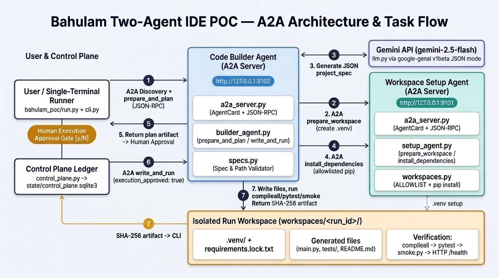
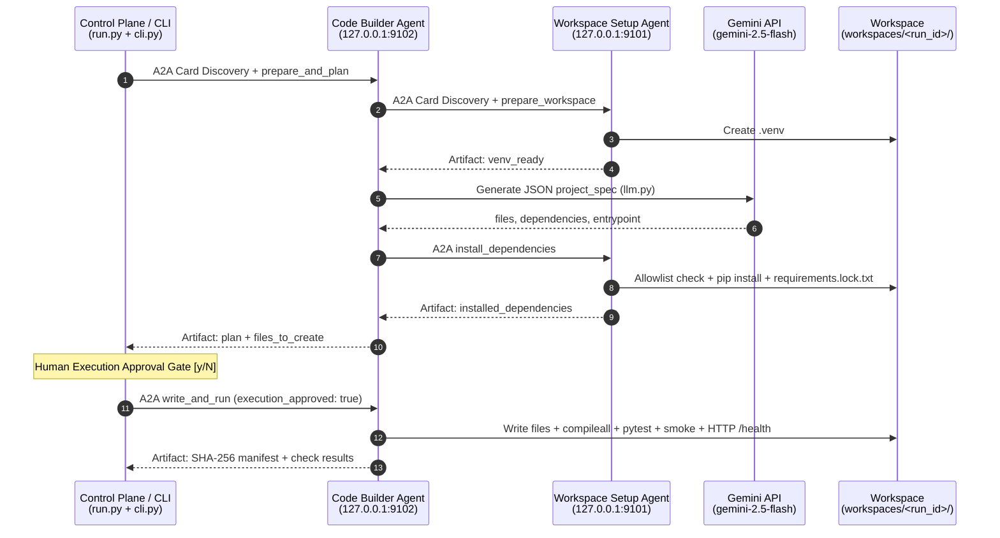

# Architecture notes



## A2A handoff sequence



## Run contract

A `run_id` is a 32-character UUID hex string. In the POC it is also the `workspace_id`. The Control Plane creates the run and passes this identifier to the Builder Agent. The identifier is validated before it is used as a workspace path.

## A2A handoff contract

Every A2A message carries JSON text with an `action` field. Every agent returns a JSON object as an A2A Artifact with media type `application/json`.

### Builder -> Setup: prepare workspace

```json
{
  "action": "prepare_workspace",
  "workspace_id": "<uuid-hex>",
  "requested_by": "code_builder_agent"
}
```

### Builder -> Setup: install dependencies

```json
{
  "action": "install_dependencies",
  "workspace_id": "<uuid-hex>",
  "dependencies": ["fastapi", "uvicorn", "httpx", "pytest"]
}
```

### Control Plane -> Builder: generate plan

```json
{
  "action": "prepare_and_plan",
  "run_id": "<uuid-hex>",
  "goal": "Build a small task tracker API"
}
```

### Control Plane -> Builder: write and run after approval

```json
{
  "action": "write_and_run",
  "run_id": "<uuid-hex>",
  "execution_approved": true,
  "project_spec": {
    "summary": "...",
    "dependencies": ["fastapi", "pytest"],
    "entrypoint": "main.py",
    "files": {"main.py": "...", "tests/test_main.py": "..."}
  }
}
```

## Ownership boundaries

- Setup Agent owns venv creation and package installation.
- Builder Agent owns project-spec generation, safe file writing, compile/tests/smoke execution and result packaging.
- Control Plane owns the run lifecycle, approval, task ID association and persistent run history.
- A2A carries messages and Task Artifacts; it is not the durable Work Graph, authorization system or sandbox.
