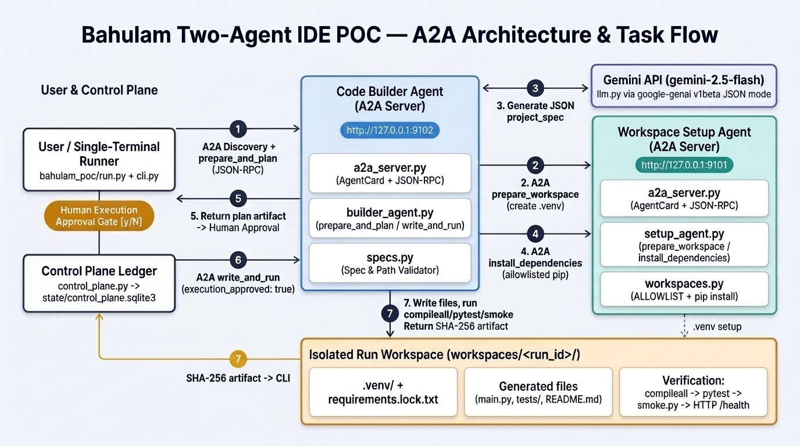
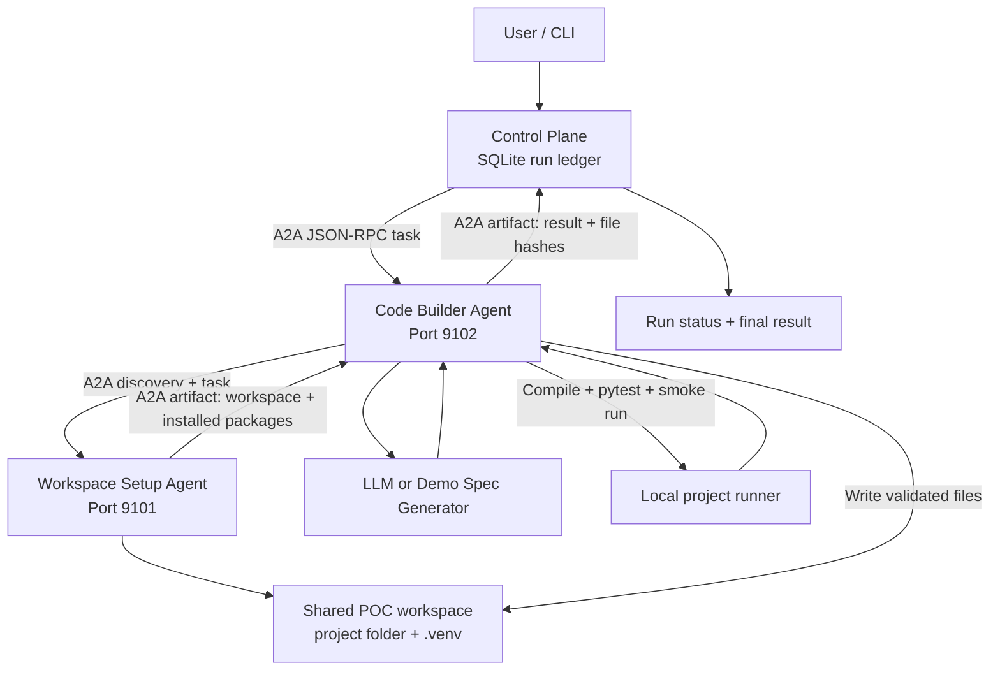

# Bahulam Two-Agent IDE POC (A2A)

A small, runnable proof of concept for the coding-agent workflow discussed in the Bahulam Agent Factory PRD.

It runs **two independent A2A servers**:

1. **Workspace Setup Agent** — creates a project folder and Python virtual environment, validates dependency names against an allowlist, and installs approved packages.
2. **Code Builder Agent** — turns a user request into a project specification, calls the Workspace Setup Agent over A2A, writes the generated files, compiles them, runs tests, runs a short smoke entrypoint, and returns an artifact manifest.

A CLI acts as the local **Control Plane / A2A client**. It creates a run record in SQLite, contacts the Builder Agent using A2A, asks for execution approval, and stores the final result. The Builder Agent is also an A2A client when it delegates workspace and dependency work to the Setup Agent. This is a real network handoff between separately running protocol servers—not direct function calls between the two agents.

## Architecture





## Bahulam mapping

| Bahulam concept | This POC implementation |
|---|---|
| Bahulam Code / user entry | CLI (`bahulam_poc.cli`) |
| Control Plane | CLI orchestration + `control_plane.py` |
| Work Graph (POC subset) | SQLite `runs`, `run_events`, and `agent_tasks` tables |
| Agent Runtime / A2A | Official A2A Python SDK, JSON-RPC protocol binding |
| Setup specialist | Workspace Setup Agent |
| Coding specialist | Code Builder Agent |
| Shared filesystem (POC only) | Local `WORKSPACE_ROOT`; both agents resolve the same `workspace_id` |
| Artifact / evidence | A2A JSON artifacts, generated file hashes, compile/test/smoke results |
| Human oversight | CLI approval before generated code is executed |
| PRD-126 sandbox | **Not implemented yet**; local virtualenv + subprocess is a development convenience, not a security sandbox |

## Live Gemini & Demo modes

By default (`LLM_MODE=gemini`), the Builder Agent uses Gemini (`GEMINI_API_KEY` and `GEMINI_MODEL`, defaulting to `gemini-2.5-flash`) to turn your prompt into a complete project specification, write files, install allowlisted dependencies via the Setup Agent, and run verification checks.

Configure `.env` (copied from `.env.example`):

```env
LLM_MODE=gemini
GEMINI_API_KEY=your_gemini_api_key
GEMINI_MODEL=gemini-2.5-flash
```

For offline smoke testing without an API key, set `LLM_MODE=demo`. The Builder then generates a deterministic FastAPI starter project containing:

- `app.py` — `/health` and `/tasks` endpoints
- `tests/test_app.py` — endpoint tests
- `main.py` — short smoke entrypoint
- `README.md`

An `openai_compatible` mode is also supported via `OPENAI_BASE_URL`, `OPENAI_API_KEY`, and `OPENAI_MODEL`. Do not commit `.env`.

## Prerequisites

- Python 3.10+ (Python 3.11 recommended)
- Internet access for installing the A2A SDK and project dependencies
- Windows PowerShell or macOS/Linux shell

The official A2A Python SDK is pinned to `a2a-sdk[http-server]==1.3.1`. The SDK supports A2A Protocol 1.0 JSON-RPC client/server communication and requires Python 3.10+. Reference: https://github.com/a2aproject/a2a-python

## Run with Docker Compose

Start both A2A agent containers (`setup-agent` on `9101` and `builder-agent` on `9102`) sharing `./workspaces`:

```bat
docker compose up -d --build
docker compose run --rm cli "Build a small task tracker API with a health endpoint and tests"
```

Pass `--approve-execution` at the end to skip the confirmation prompt, or inspect a saved run:

```bat
docker compose run --rm cli --show-run <RUN_ID>
docker compose down
```

## Run in a single terminal (recommended)

From the project folder after running setup (`.\scripts\setup.ps1` or `./scripts/setup.sh`):

```bat
.venv\Scripts\python.exe -m bahulam_poc.run "Build a small task tracker API with a health endpoint and tests"
```

This starts both A2A servers in the background (writing logs to `state/logs/`), waits until both pass discovery, runs your prompt through the Control Plane, and cleanly stops the servers on exit. Omit the prompt to enter interactive multi-prompt mode (`Prompt>`), or pass `--approve-execution` to skip the confirmation prompt.

## Run on Windows (PowerShell, separate terminals)

From the project folder:

```powershell
.\scripts\setup.ps1
.\.venv\Scripts\Activate.ps1
.\scripts\start_agents.ps1
```

The start script opens two PowerShell windows, one for each A2A agent. Keep both open.

Open a third terminal in the project folder:

```powershell
.\.venv\Scripts\python.exe -m bahulam_poc.health_check
.\.venv\Scripts\python.exe -m bahulam_poc.cli "Build a small task tracker API with a health endpoint and tests"
```

The CLI displays the planned files and installed packages. Approve execution when prompted. To skip the interactive prompt:

```powershell
.\.venv\Scripts\python.exe -m bahulam_poc.cli "Build a small task tracker API" --approve-execution
```

To inspect a saved run:

```powershell
.\.venv\Scripts\python.exe -m bahulam_poc.cli --show-run <RUN_ID>
```

## Run on macOS/Linux

```bash
./scripts/setup.sh
./scripts/start_agents.sh
```

In another terminal:

```bash
.venv/bin/python -m bahulam_poc.health_check
.venv/bin/python -m bahulam_poc.cli "Build a small task tracker API with a health endpoint and tests"
```

## A2A endpoints

- Workspace Setup Agent: `http://127.0.0.1:9101`
- Code Builder Agent: `http://127.0.0.1:9102`
- Each publishes `/.well-known/agent-card.json` for discovery.
- JSON-RPC protocol binding `1.0` is used for A2A calls.
- Messages carry JSON task payloads as text Parts; each agent returns JSON as an `application/json` artifact Part.

## Example task lifecycle

1. CLI creates a `run_id` and stores it in the local Control Plane database.
2. CLI discovers the Code Builder Agent's Agent Card and sends `prepare_and_plan` over A2A.
3. Code Builder discovers the Workspace Setup Agent and sends `prepare_workspace` over A2A.
4. Setup Agent creates `workspaces/<run_id>/.venv` and returns a Task Artifact.
5. Code Builder generates a project specification (demo template or LLM), then asks Setup Agent to install its dependencies through a second A2A task.
6. Setup Agent validates each requested package against the allowlist, installs it in the project's virtual environment, and returns its artifact.
7. Builder returns a plan to the CLI. The human approves or declines code execution.
8. On approval, CLI sends `write_and_run` to Builder over A2A.
9. Builder writes files, runs compile checks, runs pytest when tests exist, executes the finite smoke entrypoint, and (for an ASGI project) briefly starts Uvicorn on localhost to verify the HTTP health endpoint before stopping the process.
10. Builder returns an artifact with status, logs, file SHA-256 hashes, and verification results. The Control Plane stores the run result and event trail.

## Safety and POC limitations

**Important:** a Python virtual environment is dependency isolation, not a security boundary. The generated project is executed as the current OS user and may still access local files or the network. This POC is intended for generated demo projects in a disposable development environment, not untrusted repositories or production code. Keep execution approval enabled.

Safeguards included:

- Agents bind to localhost by default.
- Dependency installs are limited to a small package-name allowlist; URLs, local paths, pip flags, and arbitrary package names are rejected.
- Generated files are limited by count, size, extension, and relative-path checks.
- Generated shell scripts and arbitrary shell command execution are not supported.
- The runner executes only Python compile checks, pytest, and a declared relative `.py` smoke entrypoint.
- Execution has a timeout and does not inherit API-key environment variables.
- A human must approve generated-code execution.

Still missing for production or a stronger POC:

- PRD-126 microVM/container isolation and network policy
- Persistent A2A task store (the agents currently use the SDK's in-memory task store)
- Authentication between agents and tenant/project authorization
- Durable shared filesystem grants and artifact object storage
- Streaming task updates, explicit cancellation, retries with idempotency keys, and quotas
- More rigorous command policy and dependency lock/hash verification
- Real LLM generation quality/evaluation and language-specific build runners

## Tests

```bash
python -m pytest -q
```

The unit tests cover project-spec validation, path traversal rejection, dependency allowlisting, and Control Plane persistence. A live A2A end-to-end test requires installing dependencies and starting both agent servers.

## Main source modules

```text
bahulam_poc/
  a2a_client.py          # A2A Agent Card discovery + send_message client
  a2a_server.py          # A2A AgentExecutor + server routes
  control_plane.py       # SQLite run ledger / Work Graph POC subset
  workspaces.py          # workspace, venv and package allowlist
  llm.py                 # demo or OpenAI-compatible code generation
  specs.py               # deterministic demo spec + project validation
  agents/
    setup_agent.py       # setup agent logic
    setup_server.py      # A2A server on port 9101
    builder_agent.py     # builder + nested A2A handoffs to Setup Agent
    builder_server.py    # A2A server on port 9102
  cli.py                 # local orchestration and human approval
```

## Primary references

- Official A2A Python SDK: https://github.com/a2aproject/a2a-python
- A2A Python Quickstart: https://a2a-protocol.org/latest/tutorials/python/1-introduction/
- Agent Card and skills: https://a2a-protocol.org/latest/tutorials/python/3-agent-skills-and-card/
- Agent Executor: https://a2a-protocol.org/latest/tutorials/python/4-agent-executor/
- Starting an A2A server: https://a2a-protocol.org/latest/tutorials/python/5-start-server/
- Calling an A2A server: https://a2a-protocol.org/latest/tutorials/python/6-interact-with-server/
